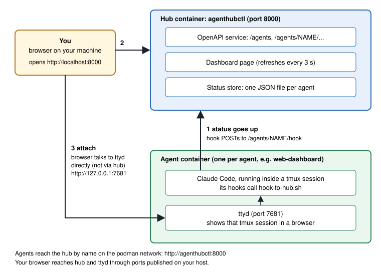
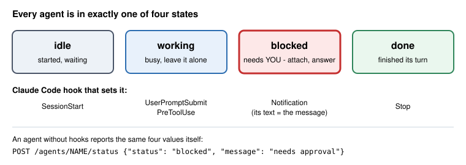

# Using agenthubctl

What a user needs to understand to use agenthubctl, nothing more.
Source: https://github.com/roebi/agenthubctl at commit `adb6c21` (v0.1.0).
The commands below are taken from that repo's scripts and README; they were
not executed while writing this guide.

## The idea in one sentence

You run n coding agents, each in its own container. agenthubctl shows you
which agent is `working`, `blocked`, `idle` or `done`, and lets you step
into any agent's live terminal from your browser.

## Four things to understand

1. **Hub** - one container (`agenthubctl`, port 8000). It stores the status
   of every agent and serves the dashboard and the HTTP API.
2. **Agent container** - one per agent. It runs the agent (for example Claude
   Code) inside tmux and shows that session through ttyd (port 7681).
3. **Status** - one of four values: `idle`, `working`, `blocked`, `done`,
   plus an optional message. Agents push it to the hub. The hub never asks.
4. **Attach** - the dashboard link opens the agent's ttyd page directly in
   your browser. It is the live session with full scrollback, and you can type.

## Picture 1: what runs where



Two different addresses, easy to mix up:

| Who | Reaches | Address |
|---|---|---|
| agent container | hub | `http://agenthubctl:8000` (podman network name) |
| your browser | hub | `http://localhost:8000` (published port) |
| your browser | agent terminal | `http://127.0.0.1:7681` (published port of that agent) |

## Picture 2: the four states



Look at `blocked` first. That is the only state that waits for you.

## Commands

All commands run in the root of a clone of `roebi/agenthubctl`.

### Start the hub

```bash
./podman_build.sh     # build the hub image, once
./podman_run.sh       # start the hub, print dashboard and API links
```

Dashboard: `http://localhost:8000/` - API spec: `http://localhost:8000/openapi.json`.
Status files live in the podman volume `agenthubctl-status` and survive restarts.

### Try it with the demo agent

```bash
examples/demo-agent/run.sh
```

Open the dashboard, click **attach** on `demo-agent`, and type:

```bash
agent-status working building the thing
agent-status blocked needs your approval
agent-status done
```

The dashboard row follows within about 3 seconds.

### Ask the hub (API)

```bash
curl -s http://localhost:8000/agents                      # all agents
curl -s http://localhost:8000/agents/demo-agent           # one agent
curl -s http://localhost:8000/agents/demo-agent/terminal  # its terminal URL

# who is blocked, and why?
curl -s http://localhost:8000/agents \
  | jq -r '.[] | select(.status == "blocked") | "\(.name): \(.message)"'
```

### Report a status by hand (agent without hooks)

```bash
curl -X POST -H 'Content-Type: application/json' \
  -d '{"status": "working", "message": "refactoring the store"}' \
  http://localhost:8000/agents/web-dashboard/status
```

### Connect a real Claude Code agent

Inside the agent container:

1. Copy `examples/claude-code-hooks/hook-to-hub.sh` to `/usr/local/bin/hook-to-hub.sh`.
2. Merge `examples/claude-code-hooks/settings.json` into `~/.claude/settings.json`.
3. Start the container with two environment variables:

```bash
AGENTHUBCTL_URL=http://agenthubctl:8000
AGENTHUBCTL_AGENT=web-dashboard
```

### Make an agent attachable

Inside the agent container, run the agent in tmux and serve it with ttyd:

```bash
agent-terminal.sh web-dashboard 7681 -- claude
```

Tell the hub where that terminal is (NAME=URL, repeat for each agent):

```bash
AGENTHUBCTL_TERMINALS="web-dashboard=http://127.0.0.1:7681" ./podman_run.sh
```

Without a container: `uv run agenthubctl --status-dir ./status --terminal web-dashboard=http://127.0.0.1:7681`

### Stop

```bash
podman rm -f agenthubctl demo-agent
```

## What it cannot do yet

- Send input to an agent through the API (a human does that in the attached terminal).
- Start, stop, restart or assign work to agents.
- Authenticate users. Run it locally only.
- The hook mapping is not yet confirmed against a live Claude Code hook call
  (stated in `examples/claude-code-hooks/README.md`).
